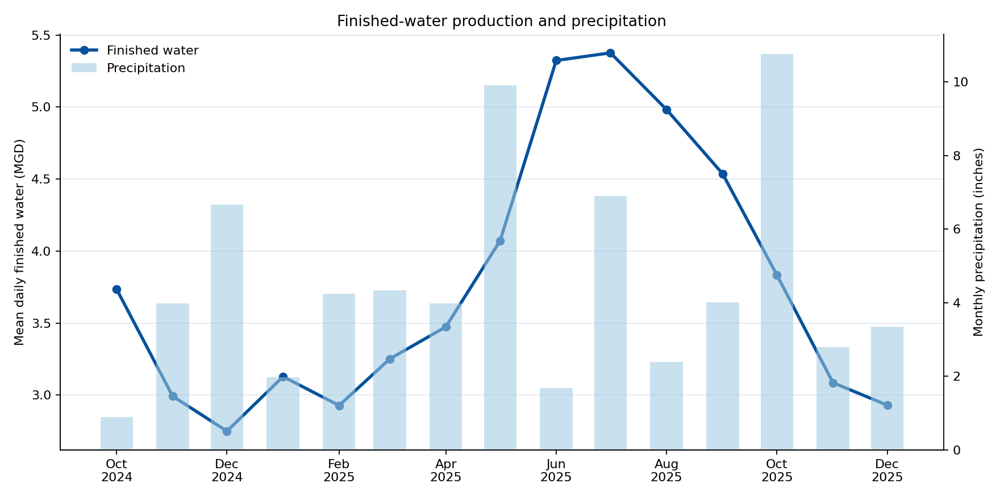
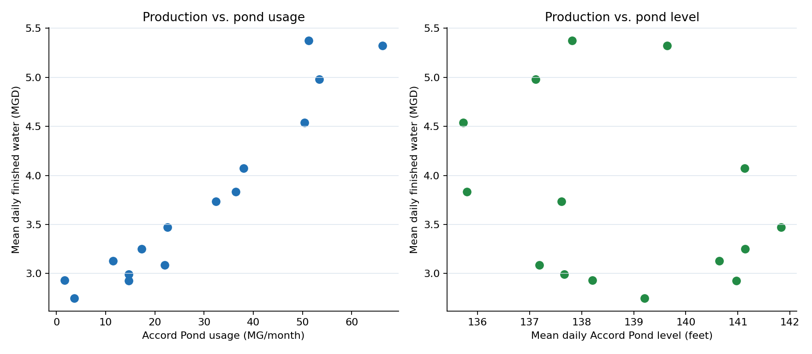
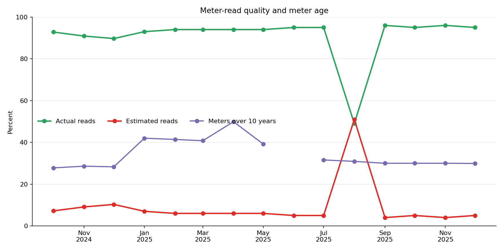
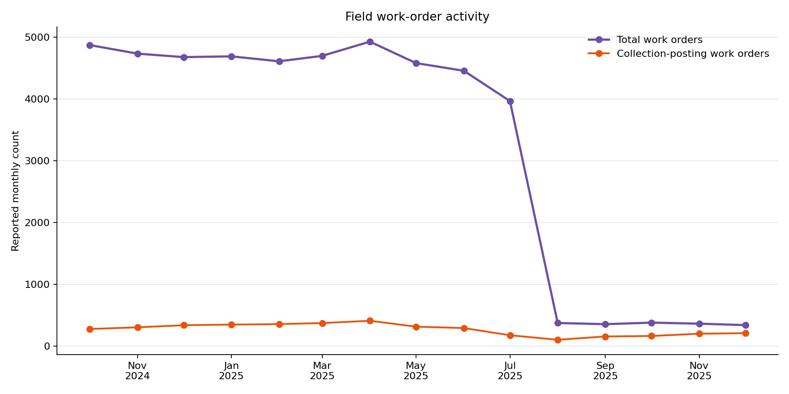

# Exploratory Analysis

This analysis covers the 15 validated Weir River Water System reports from
October 2024 through December 2025. It is descriptive and hypothesis-generating;
the short, uneven seasonal window is not sufficient for causal conclusions or a
stable seasonal model.

## Main findings

- Mean daily finished-water production ranged from
  **2.75 MGD in December 2024**
  to **5.38 MGD in July 2025**.
- Accord Pond usage had a strong positive exploratory association with finished
  water (`r = 0.96`, `n = 15`), while pond
  level had an inverse association (`r = -0.28`). These are
  correlations, not evidence that one measure causes the other.
- Monthly precipitation had little observed linear relationship with finished-water
  production in this window (`r = 0.03`,
  `p = 0.917`). More years and weather controls are needed
  before interpreting rainfall effects.
- Estimated-read percentage and meter age were associated at different strengths
  with production (`r = 0.30` and
  `r = -0.16`, respectively). These metrics should be treated
  as data-quality and system-age context, not production drivers.
- The maintenance contract showed a negative remaining balance in
  **5 report months**. Because cumulative totals were restated
  across reports, analysis uses each report's current-month snapshot rather than
  constructing a continuous cash-flow series from successive cumulative values.
- Standardized screening flagged **3 metric-month observations**
  at or beyond two standard deviations. These flags identify review candidates,
  not errors; validated source values remain unchanged.





## Strongest exploratory correlations with finished water

Pearson coefficients are shown only where at least eight paired observations
exist. With 15 months, p-values are unstable and multiple-comparison adjustment
would further reduce apparent significance.

| Feature | n | Pearson r | p-value |
|---|---:|---:|---:|
| Zinc Orthophosphate | 15 | 0.979 | <0.001 |
| Accord Pond usage | 15 | 0.959 | <0.001 |
| Sodium Hypochlorite | 15 | 0.950 | <0.001 |
| Gen Floc 610 | 15 | 0.930 | <0.001 |
| Hydrofluorosilic Acid | 15 | 0.886 | <0.001 |
| Gen Floc 620 | 15 | 0.867 | <0.001 |
| Aluminum Sulfate | 15 | 0.863 | <0.001 |
| Customer contacts | 15 | 0.721 | 0.002 |

The complete table is in
[`analysis/results/correlations_with_finished_water.csv`](../analysis/results/correlations_with_finished_water.csv).
Chemical series are compared separately by chemical; amounts with different
units are never summed. Aluminum sulfate retains the source's unresolved
`report-specific` unit.

## Meter and work-order context





The sharp August 2025 work-order change is retained as reported. Operational
event fields that are absent from a report remain `NULL`; the analysis does not
turn unreported activity into zero.

## Anomaly review candidates

| Month | Metric | Value | z-score |
|---|---|---:|---:|
| November 2024 | `maintenance_paid_usd` | 339,797.000 | 2.55 |
| August 2025 | `estimated_reads_pct` | 51.000 | 3.70 |
| October 2025 | `precipitation_inches` | 10.760 | 2.25 |

The full machine-readable output is in
[`analysis/results/anomalies.csv`](../analysis/results/anomalies.csv).

## Limits and next data needs

- Fifteen months do not provide enough repeated seasons for a robust seasonal
  model, trend decomposition, or forecasting evaluation.
- The reports contain finished-water production but not customer-consumption
  volume. Water loss cannot be calculated without billed/authorized consumption
  and a consistent production-volume denominator.
- Population, development, temperature, drought, groundwater, and permit data
  are not yet joined. Claims about growth or environmental drivers would be
  premature.
- Maintenance cumulative totals are periodically restated. Current-report
  snapshots are authoritative for this analysis; month-to-month differences of
  cumulative totals should not be interpreted as exact cash flows.
- Correlation does not establish causation, especially with small samples and
  shared seasonality.

## Reproduce

```powershell
python database/apply_schema.py
python analysis/run_exploratory_analysis.py
python -m unittest discover -s tests -v
```
